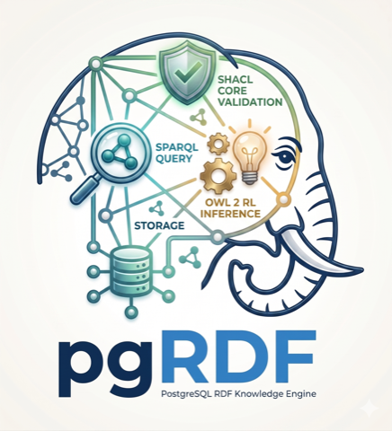

# pgRDF

[](LICENSE)
[](https://www.postgresql.org/)
[](https://github.com/styk-tv/pgRDF/actions/workflows/ci.yml)
[](./LATEST.md)
[](guide/06-validation-recipes.md)
[](guide/04-reasoning.md)

**RDF, SPARQL, SHACL and OWL reasoning inside PostgreSQL.**

pgRDF is a PostgreSQL extension written in Rust. With it you can:

- load RDF into your database;
- query and update it with SPARQL 1.1;
- reason over it with OWL 2 RL or RDFS;
- validate it with SHACL;
- fingerprint and export it.

Every operation is a SQL function call, so any PostgreSQL client
already works with it.

```sql
SELECT pgrdf.add_graph('http://example.org/people');

SELECT pgrdf.parse_turtle($$
  @prefix ex:   <http://example.org/> .
  @prefix foaf: <http://xmlns.com/foaf/0.1/> .
  ex:alice foaf:name "Alice" ; foaf:knows ex:bob .
  ex:bob   foaf:name "Bob" .
$$, pgrdf.graph_id('http://example.org/people'));

SELECT * FROM pgrdf.sparql($$
  PREFIX foaf: <http://xmlns.com/foaf/0.1/>
  SELECT ?who ?friend WHERE { ?a foaf:name ?who ; foaf:knows ?b . ?b foaf:name ?friend }
$$);
--  {"who": "Alice", "friend": "Bob"}
```

## Try it in two minutes

With Docker and nothing else, run the extension in a stock
`postgres:18` container:

```sh
VER=0.6.41
ARCH=$(uname -m | sed -e 's/x86_64/amd64/' -e 's/aarch64/arm64/')
curl -fsSL https://github.com/styk-tv/pgRDF/releases/download/v$VER/pgrdf-$VER-pg18-glibc-$ARCH.tar.gz | tar -xz

docker create --name pgrdf -e POSTGRES_PASSWORD=pgrdf -p 5432:5432 \
  postgres:18 -c shared_preload_libraries=pgrdf
docker cp pgrdf-$VER-pg18-glibc-$ARCH/lib/pgrdf.so       pgrdf:/usr/lib/postgresql/18/lib/
docker cp pgrdf-$VER-pg18-glibc-$ARCH/share/extension/.  pgrdf:/usr/share/postgresql/18/extension/
docker start pgrdf

until docker exec pgrdf pg_isready -h localhost -U postgres -q; do sleep 1; done
docker exec -it pgrdf psql -U postgres -c 'CREATE EXTENSION pgrdf'
docker exec -it pgrdf psql -U postgres
```

Then follow **[the ten-minute tour](guide/tour.md)**: load a graph,
query it, reason over it, validate it, lock it and fingerprint it.
When you're done, `docker rm -f pgrdf` removes everything.

Other ways to install (your own image, an existing server, Kubernetes,
from source) are in the [install guide](guide/01-install.md).

## What's inside

| | |
|---|---|
| **Load** | Turtle, N-Triples, TriG, N-Quads, from SQL strings or server files. Parallel loaders for very large N-Triples dumps. A graph is a set of triples: loading a triple it already holds stores nothing, and each load reports what it read, stored and dropped. → [Loading](guide/02-loading-rdf.md) |
| **Query** | SPARQL 1.1: `SELECT`, `ASK`, `CONSTRUCT`, `DESCRIBE`; `OPTIONAL`, `UNION`, `MINUS`, `VALUES`, `BIND`, subqueries, aggregates, property paths, named graphs. Results are JSONB rows you can join with any table. → [Querying](guide/03-querying.md) |
| **Update** | SPARQL 1.1 UPDATE: `INSERT` / `DELETE` `DATA`, `INSERT` / `DELETE … WHERE`, `CREATE` / `CLEAR` / `DROP GRAPH`. Transactional like any SQL. → [Update](guide/03-querying.md#sparql-update) |
| **Reason** | OWL 2 RL or RDFS materialization, stored beside your data and never mixed into it, with a freshness flag that tells you when to re-run. → [Reasoning](guide/04-reasoning.md) |
| **Validate** | SHACL Core plus SHACL-SPARQL, with the report returned as JSONB. 56 of the 98 W3C SHACL Core tests are run on every change and all pass, graded on the `sh:conforms` verdict (the suite's partial compliance; full reports are not compared). → [Validation](guide/06-validation-recipes.md) |
| **Manage graphs** | Inventory with source digests, copy / move / clear / drop, carve out subgraphs by predicate or neighbourhood, write locks that hold against plain SQL too, integrity checks. Any role with table grants can create graphs. → [Graphs](guide/05-graphs.md) |
| **Know who did what** | Each graph records its owner. Every graph-level act (create, load, update, clear, lock, validate, …) is one row in an act record that pgRDF writes and a role with table grants cannot forge, with the PostgreSQL role that acted kept apart from what the client declares about itself. → [The act record](guide/05-graphs.md#the-act-record) |
| **Identify, compare, export** | Canonical graph digests (W3C RDFC-1.0), a blank-node-aware diff between two graphs, canonical N-Triples export, and a manifest anyone can check offline with `sha256sum`. → [Identity](guide/07-identity-and-export.md) |
| **Diagnose** | SQLSTATE codes that say what kind of refusal an error is, per-query completeness figures, and a queryable list of supported functions. → [Diagnostics](guide/08-errors-and-diagnostics.md) |

## Scale

The same extension runs a few triples in a container and very large
graphs on one server:

- a complete **Wikidata "truthy" dump, 8.2 billion triples**, loaded
  into a single instance;
- the full load → reason → query pipeline at **LUBM-500**, ending in a
  112-million-quad materialized closure.

## Documentation

- **[pgrdf.styk.tv](https://pgrdf.styk.tv)**: the documentation site,
  with feature deep dives, worked examples and the internals.
- **[User guide](guide/)**: install, the tour, loading, querying,
  reasoning, graphs, validation, identity, diagnostics, and a
  [function reference](guide/09-function-reference.md).
- **Client examples**: [Python](guide/clients/python.md) ·
  [Node.js / TypeScript](guide/clients/typescript.md) ·
  [Go](guide/clients/go.md) · [Rust](guide/clients/rust.md)
- **[CHANGELOG.md](CHANGELOG.md)**: what changed in each release.

## Releases and verification

The current version, per-architecture digests and pull commands are in
[LATEST.md](LATEST.md). Every release ships:

- archives with `SHA256SUMS` on the
  [releases page](https://github.com/styk-tv/pgRDF/releases);
- a signed OCI bundle whose origin you can verify with one command:

  ```sh
  gh attestation verify oci://ghcr.io/styk-tv/pgrdf-bundle:0.6.37 --repo styk-tv/pgRDF
  ```

## Building from source

See [INSTALL.md](INSTALL.md) (Rust + `cargo-pgrx`) and
[compose/README.md](compose/README.md) (Docker-based development
setup). How pgRDF works inside is described in the
[internals](https://pgrdf.styk.tv/v0.6/internals/) section of the
documentation site. Bug reports and questions:
[issues](https://github.com/styk-tv/pgRDF/issues).

## License

[MIT](LICENSE) — © Peter Styk.
